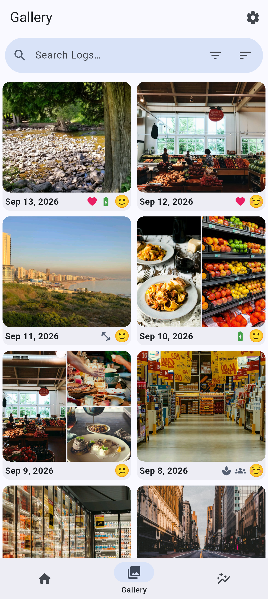
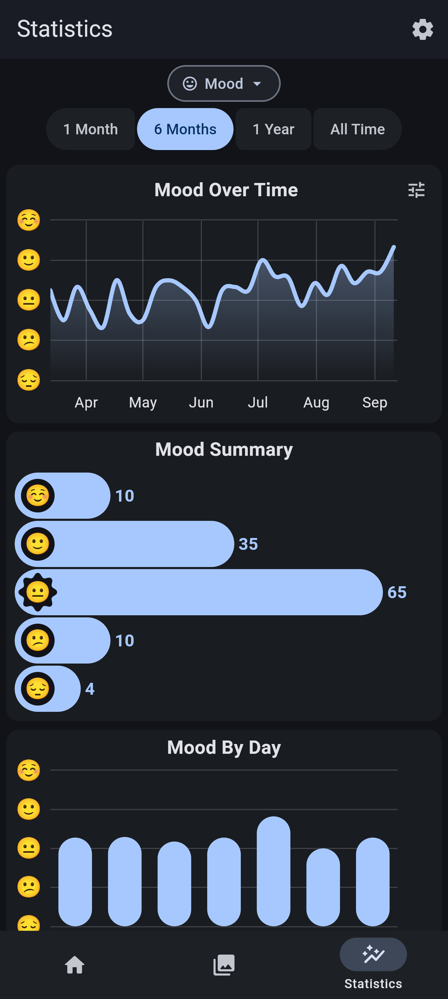
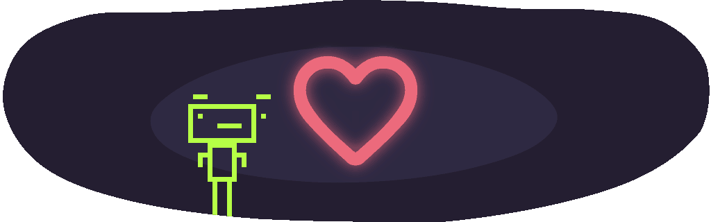

# Nhật Ký Việt

Bản Việt hóa độc lập dựa trên [Daily You](https://github.com/Demizo/Daily_You) của **Demizo và cộng đồng**, không phải ứng dụng chính thức. Giữ nguyên giấy phép GPL và các thông báo bản quyền của dự án gốc.

- Mã nguồn bản Việt hóa: https://github.com/khanhx419/Dail_You
- Ngôn ngữ mặc định: **tiếng Việt**, kể cả khi thiết bị dùng tiếng Anh.
- Bài chào mừng, mẫu nhật ký, nhãn và thông báo được khởi tạo theo ngôn ngữ ứng dụng.
- Tên hiển thị: **Nhật Ký Việt**; Android application ID: `vn.khanhx419.nhatkyviet`.
- Có thể đổi ngôn ngữ tại **Cài đặt → Ngôn ngữ**. Chọn **Hệ thống** để theo ngôn ngữ thiết bị; thiết bị có ngôn ngữ chưa hỗ trợ sẽ dùng tiếng Việt.
- Nội dung người dùng đã nhập hoặc đã nhập từ bản sao lưu được giữ nguyên.

## Chạy bản web trên localhost

Yêu cầu Flutter 3.47.2 (Dart 3.13.2) và Python 3. Không cần máy ảo Android.

```powershell
flutter pub get
flutter gen-l10n
flutter build web --target lib/main_web.dart --no-web-resources-cdn
python -m http.server 8080 --bind 127.0.0.1 --directory build/web
```

Mở **http://localhost:8080**. Giữ nguyên địa chỉ và cổng để tiếp tục dùng cùng kho dữ liệu. Khi phát triển có thể chạy `flutter run -d chrome --target lib/main_web.dart --web-port 8080`.

Bản web hỗ trợ viết/sửa/xóa nhật ký, tâm trạng, nhãn, tìm kiếm, lọc ngày, mẫu nội dung, xem trước Markdown, ảnh, thống kê, giao diện sáng/tối và sao lưu/khôi phục JSON. Dữ liệu lưu trong trình duyệt, không tự tải lên máy chủ. Tệp sao lưu có định dạng riêng `nhat-ky-viet-web`, chưa nhập trực tiếp bản sao lưu SQLite/ZIP của Android. Mỗi nhật ký tối đa 3 ảnh, mỗi ảnh 1,5 MB; tổng dung lượng phụ thuộc hạn mức bộ nhớ của trình duyệt.

Các tính năng dùng dịch vụ Android như nhắc nhở nền, sinh trắc học, đồng bộ thư mục ngoài, quay video/ghi âm và sao lưu tự động không có trong giao diện web. Nguồn Android vẫn được giữ lại, nhưng việc build và chạy máy ảo đã dừng theo yêu cầu.

## Kiểm tra

```powershell
flutter analyze
flutter test test/web_journal_test.dart test/vietnamese_localization_test.dart test/utils/attachment_file_name_test.dart
```

## Bản dịch và kiểm tra

Sửa `lib/l10n/intl_vi.arb`, sau đó chạy `flutter gen-l10n`. Có 297 thông điệp tiếng Việt; tên thương hiệu, định dạng JSON/Markdown và các ký hiệu kỹ thuật được giữ nguyên khi cần thiết.

`test/vietnamese_localization_test.dart` kiểm tra độ đầy đủ, tham số ICU, ngôn ngữ mặc định, câu có số lượng, tiến độ sao lưu và hiển thị trên màn hình hẹp. Bộ kiểm thử gốc bao gồm cơ sở dữ liệu, sao lưu/khôi phục, mã hóa, nhập/xuất, đồng bộ và trình soạn thảo. Xem `VIETNAMESE_QA.md` để biết kết quả chạy thực tế và giới hạn kiểm chứng.

---

## Tài liệu dự án gốc

<p align="center">

</p>
<div align="center">
  
# Daily You

[](https://f-droid.org/en/packages/com.demizo.daily_you/)
[](https://apt.izzysoft.de/fdroid/index/apk/com.demizo.daily_you)
[](https://github.com/Demizo/Daily_You/releases/latest)

[](https://liberapay.com/Daily-You/donate)
[](https://buymeacoffee.com/demizo)

### Every day is worth remembering…

---

</div>

Capture the moments that matter. **Daily You** helps you log your thoughts, track your mood, and keep a diary of meaningful moments, every day. Whether you're journaling, reflecting, or just noting what made you smile, **Daily You** gives you a private space that's truly your own.

Join a community that believes **your journal should be yours**, not a product.

<p align="center">




</p>

### Features

✍️ **Take daily logs:** Journal your thoughts, reflections, or routines.

📈 **Track your mood:** Gain insight into how your mood changes over time.

🖼️ **Keep photo memories:** Add pictures to enrich your memories.

📝 **Rich note taking:** Format notes your own way with Markdown.

🔔 **Gentle reminders:** Random daily nudges to keep you consistent.

🔒 **Control your data:** Choose where your data lives, including external storage.

🌐 **Offline-first:** Works without internet. Always.

**Daily You** is free, open source, and community supported. Built around the belief that your diary should be yours forever, not a subscription. No accounts, no ads, no locked features, and no tracking or data collection. Just your story, on your device, owned by you.

---

<p align="center">

</p>

<div align="center">

## Download

[](https://github.com/Demizo/Daily_You/releases)
[](https://shields.rbtlog.dev/com.demizo.daily_you)

[](https://f-droid.org/en/packages/com.demizo.daily_you/)
[](https://apt.izzysoft.de/fdroid/index/apk/com.demizo.daily_you)
[](https://github.com/Demizo/Daily_You/releases/latest)

</div>

### Migrate From Another App
Are you coming from another app? Simply go to `Settings > Backup & Restore > Import From Another App` to import a backup from another app. Feel free to request any apps not currently listed. **Note:** Imports from some apps may not be one-to-one since **Daily You** may have different features.

### Development
The full development environment is defined using [Nix](https://nixos.org/). Simply, install the [Nix Package Manager](https://nixos.org/download/), clone the repository, enter the project directory, and run `nix develop`, that's it! Alternatively, **Daily You** is built using Flutter. You can directly [install Flutter](https://docs.flutter.dev/get-started/install), clone the repository, enter the project directory, and run `flutter pub get`.

---

<p align="center">

</p>

<div align="center">
  
## Support The App

</div>

**Daily You** is _free forever_ since everyone deserves a journal that is truly their own. If you find yourself enjoying the app, please consider supporting its continued development.

[](https://liberapay.com/Daily-You/donate)
[](https://buymeacoffee.com/demizo)

### Translations 
**Daily You** uses [Weblate](https://weblate.org) to easily manage translations. If you would like to help translate the app, please visit [the Daily You project on Weblate](https://hosted.weblate.org/projects/daily-you/). Everyone should have access to a journal!


## License
This software is free software licensed under the [GNU General Public License 3.0](LICENSE.txt). Additional terms under section 7 of that license apply; see [ADDITIONAL_TERMS.md](ADDITIONAL_TERMS.md).
